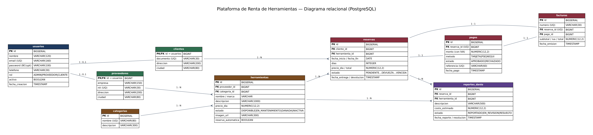

# Plataforma de Renta de Herramientas y Equipos de Construcción

Aplicación web completa (backend + frontend) para que **proveedores** publiquen su inventario de herramientas y **clientes** las alquilen por fechas, paguen en línea y descarguen su factura. Un **administrador** supervisa usuarios, alquileres, pagos, daños y reportes.

> Repositorio sugerido: `Proyecto_RentaHerramientas_BonillaAbel`

## Tecnologías

| Capa | Tecnología |
|---|---|
| Lenguaje | Java 21 |
| Framework | Spring Boot 3.5.16 (Web, Validation, Data JPA, Security) |
| Seguridad | Spring Security + **JWT** (jjwt 0.12.6), contraseñas con **BCrypt** |
| Base de datos | **PostgreSQL** 13+ (migraciones con **Flyway**) |
| Documentación | **Swagger / OpenAPI** (springdoc 2.8.9) |
| Facturas PDF | OpenPDF |
| Frontend | HTML + CSS + JavaScript puro (módulos ES, sin frameworks), responsivo |
| Servidor | **Apache Tomcat embebido** (incluido en `spring-boot-starter-web`) |
| Pruebas | JUnit 5, Mockito, Spring Security Test, Postman |

## Arquitectura hexagonal (puertos y adaptadores) en Maven multimódulo

El proyecto se divide en **5 módulos Maven**. Las dependencias apuntan siempre hacia adentro y el dominio no depende de Spring, JPA ni HTTP. Las reglas se verifican automáticamente con **ArchUnit** (`platform/src/test/.../architecture`).

```
platform ─▶ api ─────────────┐
   │                          ▼
   └──────▶ infrastructure ─▶ application ─▶ domain
```

| Módulo | Responsabilidad | Depende de |
|---|---|---|
| `domain` | Núcleo: modelos, excepciones de negocio, objetos de valor (`Dinero`, `Email`, `Nit`) y **puertos de salida** | nada (Java puro) |
| `application` | Casos de uso: puertos de entrada (`port.in`) y servicios (`@Service`, `@Transactional`) | `domain` |
| `infrastructure` | Adaptadores de salida: JPA/PostgreSQL, migraciones Flyway, PDF, pasarela de pago, imágenes | `application`, `domain` |
| `api` | Adaptador de entrada HTTP: controllers REST, DTOs con validación, manejo global de errores, OpenAPI | `application`, `domain` |
| `platform` | Arranque Spring Boot, seguridad JWT, configuración web, tareas programadas, `application.properties`, frontend estático | todos |

```
com.rentaherramientas
├── domain/
│   ├── model/                    Reserva (con sus transiciones de estado), Herramienta, Pago, Factura...
│   ├── exception/                Excepciones de negocio (404, 400, 409, 403, 401)
│   ├── port/out/                 Puertos de salida (lo que la app NECESITA): ReservaRepositoryPort, PaymentGatewayPort...
│   └── value/                    Objetos de valor: Dinero, Email, Nit
├── application/
│   ├── port/in/                  Puertos de entrada (lo que la app OFRECE): ReservaUseCase, PagoUseCase...
│   └── service/                  Implementación de los casos de uso
├── infrastructure/
│   ├── persistence/              adapter/ (implementan los puertos), entity/ (JPA), mapper/, repository/ (Spring Data)
│   ├── pdf/                      Facturas en PDF (OpenPDF)
│   ├── payment/                  Pasarela de pago simulada (intercambiable)
│   └── storage/                  Imágenes en disco
├── api/
│   ├── controller/               Controllers REST
│   ├── dto/                      Request/Response con validación
│   ├── exception/                GlobalExceptionHandler + ApiError
│   ├── openapi/                  Configuración Swagger
│   └── security/                 ActorResolver, AuthenticatedUser (usuario autenticado → Actor del dominio)
├── platform/
│   ├── security/                 SecurityConfig, JWT, filtro de autenticación, handlers 401/403, BCrypt
│   ├── config/                   WebConfig (recursos /uploads, tareas programadas)
│   └── scheduler/                Vencimiento automático de reservas
└── RentaHerramientasApplication  Clase principal (en el paquete raíz para que Spring escanee todos los módulos)
```

Beneficio práctico: cambiar la pasarela de pagos (Wompi, PayU…) o el almacenamiento (S3) es **crear un adaptador nuevo** en `infrastructure`; el dominio y los servicios no se tocan.

## Requisitos previos

- **JDK 21** y **Maven 3.9+** (`java -version`, `mvn -v`)
- **PostgreSQL 13+** (o Docker)

## Cómo ejecutarlo

```bash
# 1. Clonar
git clone https://github.com/<tu-usuario>/Proyecto_RentaHerramientas_BonillaAbel.git
cd Proyecto_RentaHerramientas_BonillaAbel

# 2. Base de datos (opción A: Docker)
docker compose up -d
#    (opción B: PostgreSQL instalado)  psql -U postgres -c "CREATE DATABASE renta_herramientas;"

# 3. Compilar todos los módulos y arrancar (Maven descarga las dependencias)
mvn clean package -DskipTests
java -jar platform/target/renta-herramientas-1.0.0.jar
```

Al arrancar, **Flyway crea las tablas y carga los datos de prueba** automáticamente (`infrastructure/src/main/resources/db/migration`). La base debe estar **vacía** la primera vez.

| Qué | URL |
|---|---|
| Aplicación web | http://localhost:8080 |
| Swagger (API) | http://localhost:8080/swagger-ui.html |
| OpenAPI JSON | http://localhost:8080/v3/api-docs |

### Cuentas de prueba (datos del script SQL)

| Rol | Correo | Contraseña |
|---|---|---|
| Administrador | `admin@rentaherramientas.com` | `Admin123*` |
| Proveedor (01 a 22) | `proveedor01@rentaherramientas.com` | `Proveedor123*` |
| Cliente (01 a 22) | `cliente01@rentaherramientas.com` | `Cliente123*` |

## Configuración (`application.properties`)

Todo se puede sobrescribir con variables de entorno.

```properties
spring.datasource.url=${DB_URL:jdbc:postgresql://localhost:5432/renta_herramientas}
spring.datasource.username=${DB_USER:postgres}
spring.datasource.password=${DB_PASSWORD:postgres}

spring.jpa.hibernate.ddl-auto=validate        # el esquema lo crea Flyway; Hibernate solo lo valida
spring.flyway.enabled=true

app.jwt.secret=${JWT_SECRET:<base64 de 64 bytes>}   # ¡cámbialo en producción!
app.jwt.expiration-minutes=${JWT_EXPIRATION_MINUTES:120}
app.cors.allowed-origins=${CORS_ORIGINS:http://localhost:3000,http://localhost:5173,http://localhost:5500,http://127.0.0.1:5500,http://localhost:8080}
app.storage.upload-dir=${UPLOAD_DIR:uploads}
server.port=8080
```

Generar un secreto JWT propio: `openssl rand -base64 64`

> **Importante:** usa **Flyway o los scripts manuales**, no ambos sobre la misma base. Si prefieres ejecutar los scripts a mano, están en `database/` (`00_crear_base_de_datos.sql`, `01_crear_esquema.sql`, `02_datos_iniciales.sql`) y pon `spring.flyway.enabled=false`.

## Base de datos

- **Scripts:** `database/01_crear_esquema.sql` (tablas, claves, restricciones CHECK, índices) y `database/02_datos_iniciales.sql`.
- **Datos de prueba:** 45 usuarios · 22 proveedores · 22 clientes · 10 categorías · 41 herramientas · 40 reservas (en todos los estados) · 30 pagos · 30 facturas · 6 reportes de daño.
- **Diagrama relacional:** `docs/diagrama_relacional.png` (fuente editable: `docs/diagrama_relacional.dot`).



Decisiones de diseño: proveedores y clientes comparten la PK de `usuarios` (relación 1 a 1); las eliminaciones son **lógicas** (se conserva el historial); `reservas` congela el precio del día; `pagos.reserva_id` y `facturas.reserva_id` son únicos (una reserva, un pago, una factura); índice compuesto `(herramienta_id, fecha_inicio, fecha_fin)` para validar disponibilidad.

## Autenticación y roles

1. `POST /api/auth/login` devuelve un **JWT** (`token`).
2. Se envía en cada petición: `Authorization: Bearer <token>`.
3. El token contiene el id, correo y rol; expira a los 120 min (configurable). Un usuario desactivado pierde el acceso aunque su token no haya vencido.

| Acción | ADMIN | PROVEEDOR | CLIENTE | Público |
|---|:-:|:-:|:-:|:-:|
| Ver catálogo, categorías, disponibilidad | ✅ | ✅ | ✅ | ✅ |
| Registrarse (cliente) / iniciar sesión | | | | ✅ |
| CRUD proveedores y clientes | ✅ | solo su perfil | solo su perfil | |
| CRUD categorías | ✅ | | | |
| CRUD herramientas + imágenes | todas | solo las suyas | | |
| Solicitar / cancelar reservas | cancelar | | ✅ (las suyas) | |
| Aprobar, rechazar, entregar, recibir | ✅ | solo sus herramientas | | |
| Pagar en línea | | | ✅ | |
| Facturas y pagos (consulta/PDF) | todos | los suyos | los suyos | |
| Reportar / gestionar daños | gestiona | reporta | | |
| Reportes y estadísticas | toda la plataforma | solo lo suyo | | |

La seguridad se aplica en **dos niveles**: `@PreAuthorize` por rol en cada endpoint y verificación de propiedad del recurso en los servicios (un proveedor no puede tocar herramientas ni reservas de otro). Respuestas: `401` sin token/token inválido, `403` rol o propiedad no permitidos.

## Reglas de negocio principales

- **Disponibilidad:** una herramienta no se puede reservar si hay otra reserva activa (pendiente, aprobada, pagada o entregada) que se cruce en fechas, ni si está en mantenimiento o dañada. La herramienta se bloquea (`SELECT ... FOR UPDATE`) al reservar para evitar que dos clientes tomen las mismas fechas a la vez.
- **Ciclo de la reserva:** `PENDIENTE → APROBADA → PAGADA → ENTREGADA → DEVUELTA` (salidas: `RECHAZADA`, `CANCELADA`, `VENCIDA`). Si la herramienta tiene *confirmación automática*, la reserva nace `APROBADA`.
- **Pago y factura:** el pago cobra subtotal + **IVA 19 %**, marca la reserva `PAGADA` y **genera la factura automáticamente** (numeración consecutiva `FAC-AAAA-000001`) descargable en PDF. La pasarela es **simulada**: terminar en `0000` simula un pago rechazado.
- **Daños:** al devolver con daños se crea la incidencia y la herramienta pasa a `DANADA`; al resolverla (admin) vuelve a `DISPONIBLE`.
- **Vencimiento:** cada 10 min una tarea marca como `VENCIDA` las reservas pendientes > 48 h, aprobadas sin pago > 72 h o con fecha de inicio ya pasada.

## Endpoints

Documentación interactiva con ejemplos en **Swagger** (`/swagger-ui.html`, botón *Authorize* para pegar el JWT).

| Módulo | Método y ruta | Rol |
|---|---|---|
| Auth | `POST /api/auth/registro` · `POST /api/auth/login` · `GET /api/auth/me` | público / autenticado |
| Categorías | `GET /api/categorias` (público) · `POST` · `PUT /{id}` · `DELETE /{id}` | ADMIN |
| Herramientas | `GET /api/herramientas?q=&categoriaId=&desde=&hasta=&soloDisponibles=` · `GET /{id}` · `GET /{id}/disponibilidad?desde=&hasta=` | público |
| | `GET /api/herramientas/gestion` · `POST` · `PUT /{id}` · `DELETE /{id}` · `POST /{id}/imagen` (multipart `archivo`) | ADMIN, PROVEEDOR |
| Proveedores | `GET` · `POST` · `DELETE /{id}` | ADMIN |
| | `GET /{id}` · `PUT /{id}` | ADMIN o el mismo proveedor |
| Clientes | `GET` · `POST` · `DELETE /{id}` | ADMIN |
| | `GET /{id}` · `PUT /{id}` | ADMIN o el mismo cliente |
| Reservas | `POST /api/reservas` | CLIENTE |
| | `GET /api/reservas` · `GET /{id}` (según rol) | autenticado |
| | `PATCH /{id}/aprobar` · `/rechazar` · `/entregar` · `/devolver` | ADMIN, PROVEEDOR dueño |
| | `PATCH /{id}/cancelar` | CLIENTE dueño, ADMIN |
| Pagos | `POST /api/pagos` | CLIENTE |
| | `GET /api/pagos` · `GET /{id}` | autenticado (según rol) |
| Facturas | `GET /api/facturas` · `GET /{id}` · `GET /reserva/{reservaId}` · `GET /{id}/pdf` | autenticado (según rol) |
| | `POST /api/facturas/reserva/{reservaId}` | ADMIN, PROVEEDOR dueño |
| Daños | `GET /api/danios` · `POST /api/danios` | ADMIN, PROVEEDOR |
| | `PATCH /api/danios/{id}/estado` | ADMIN |
| Reportes | `GET /api/reportes/resumen` · `/ingresos` · `/herramientas-mas-alquiladas` · `/clientes-frecuentes` · `/disponibilidad` | ADMIN, PROVEEDOR |

### Ejemplos JSON

**Login** — `POST /api/auth/login`
```json
{ "email": "cliente01@rentaherramientas.com", "password": "Cliente123*" }
```
```json
{ "token": "eyJhbGciOiJIUzUxMiJ9...", "tipo": "Bearer", "expiraEnSegundos": 7200,
  "usuario": { "id": 24, "nombre": "Laura Gómez", "email": "cliente01@rentaherramientas.com", "telefono": "3200666000", "rol": "CLIENTE", "activo": true } }
```

**Crear herramienta** — `POST /api/herramientas` (PROVEEDOR)
```json
{ "categoriaId": 1, "nombre": "Rotomartillo SDS Plus 800W", "descripcion": "Incluye brocas", "marca": "Bosch",
  "precioDia": 45000, "estado": "DISPONIBLE", "reservaAutomatica": false }
```

**Solicitar reserva** — `POST /api/reservas` (CLIENTE)
```json
{ "herramientaId": 23, "fechaInicio": "2026-12-10", "fechaFin": "2026-12-12", "observaciones": "Entrega en obra" }
```
```json
{ "id": 41, "herramienta": "Taladro...", "dias": 3, "subtotal": 135000, "iva": 25650.00, "totalConIva": 160650.00, "estado": "PENDIENTE" }
```

**Pagar** — `POST /api/pagos` (CLIENTE, reserva `APROBADA`)
```json
{ "reservaId": 41, "metodo": "PSE", "ultimosDigitos": "4242" }
```
```json
{ "pago": { "id": 31, "monto": 160650.00, "estado": "APROBADO", "referencia": "PAY-3F9A..." },
  "factura": { "id": 31, "numero": "FAC-2026-000031", "subtotal": 135000, "iva": 25650.00, "total": 160650.00 } }
```

**Confirmar devolución con daño** — `PATCH /api/reservas/41/devolver`
```json
{ "hayDanio": true, "descripcionDanio": "Carcasa rota", "costoEstimado": 120000 }
```

**Error estándar** (cualquier fallo)
```json
{ "timestamp": "2026-10-24T14:30:00", "status": 409, "error": "Conflict",
  "message": "La herramienta ya está reservada en alguna de las fechas seleccionadas", "path": "/api/reservas", "details": [] }
```

## Frontend

Páginas en `platform/src/main/resources/static`, servidas por el mismo Tomcat (sin build):

- `/index.html` catálogo público con filtros por categoría, texto y fechas libres.
- `/pages/login.html`, `/pages/register.html`
- `/pages/admin.html` · `/pages/proveedor.html` · `/pages/cliente.html`: panel con menú propio por rol.

Responsivo (móvil, tableta y escritorio), JavaScript con módulos ES y escape de HTML en todo dato de la API (protección XSS). Si prefieres abrirlo con *Live Server* (puerto 5500), la API se detecta en `localhost:8080` y CORS ya lo permite.

## Pruebas

```bash
mvn test                      # pruebas de los 5 módulos (no necesitan base de datos)

# Pruebas de integración de seguridad (requieren una base PostgreSQL VACÍA):
DB_URL=jdbc:postgresql://localhost:5432/renta_test DB_USER=postgres DB_PASSWORD=postgres mvn test
```

- **Unitarias:** transiciones de estado de reserva, objetos de valor (`Dinero`, `Email`, `Nit`), reglas de reserva (solapamientos, fechas, confirmación automática, propiedad), pago + IVA + factura, facturación (permisos, idempotencia, PDF), reportes (alcance por rol), JWT (válido, vencido, manipulado), almacenamiento seguro de imágenes.
- **Arquitectura (ArchUnit):** existen los 5 módulos, `domain` es Java puro, `application` solo depende de `domain`, `api` e `infrastructure` no se conocen entre sí, las entidades JPA solo viven en `infrastructure.persistence.entity` y no hay ciclos entre módulos.
- **Integración:** login, 401 sin token, 403 por rol, catálogo público, resumen de admin.
- **Postman:** importa `postman/RentaHerramientas.postman_collection.json` y ejecútala con el *Runner* (en orden). Incluye login por rol, protección de rutas, flujo completo (reservar → aprobar → pagar → factura PDF → entregar → devolver), CRUD y reportes, con aserciones automáticas.

## Despliegue en Apache Tomcat

La aplicación incluye **Tomcat embebido**: `mvn clean package` genera `platform/target/renta-herramientas-1.0.0.jar` (jar ejecutable con todos los módulos) y se ejecuta con:

```bash
java -jar platform/target/renta-herramientas-1.0.0.jar

# Producción (Swagger desactivado, logs reducidos):
java -jar platform/target/renta-herramientas-1.0.0.jar --spring.profiles.active=prod
```

(Variables de producción: `DB_URL`, `DB_USER`, `DB_PASSWORD`, `JWT_SECRET`, `CORS_ORIGINS`, `UPLOAD_DIR`.) Si el trainer exige un Tomcat externo, basta con cambiar `<packaging>war</packaging>` en `platform/pom.xml`, extender `SpringBootServletInitializer` en la clase principal y marcar `spring-boot-starter-tomcat` como `provided`.

## Estructura del repositorio

```
├── pom.xml                      POM padre (módulos, versiones de dependencias)
├── docker-compose.yml           PostgreSQL listo para usar
├── database/                    Scripts SQL (esquema + datos)
├── docs/                        Diagrama relacional
├── postman/                     Colección de pruebas de API
├── domain/                      Módulo: modelos, excepciones, value objects, puertos de salida
├── application/                 Módulo: casos de uso
├── infrastructure/              Módulo: JPA, Flyway (src/main/resources/db/migration), PDF, pago, storage
├── api/                         Módulo: controllers, DTOs, errores, OpenAPI
└── platform/                    Módulo: arranque, seguridad, config
    └── src/main/resources/
        ├── application.properties
        ├── application-prod.properties
        └── static/              Frontend (HTML, CSS, JS)
```

Cada módulo tiene su propio `src/main/java` y `src/test/java`.

## Autor

Óscar Abel Bonilla García
